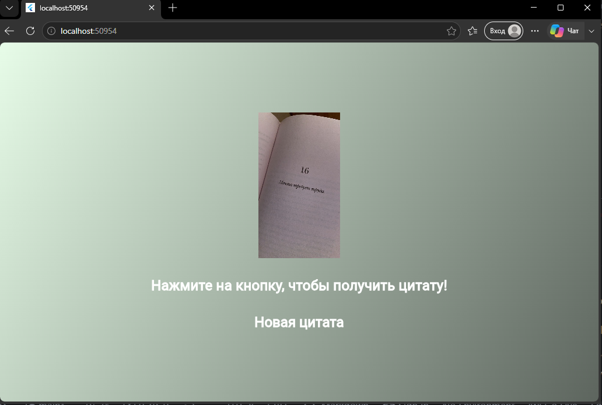

# Quote App (Лабораторная работа №6)

**Тема:** Приложение "Цитата дня".
**Описание:** Приложение показывает случайную мотивирующую цитату из заранее подготовленного списка и меняет тематическую картинку при нажатии кнопки.

## Автор

**Фамилия, Имя:** Коновалова Алиса
**Группа:** [Твоя группа]
**Дата сдачи:** 12.11.2026

## Стек и версии

- Flutter 3.35+
- Dart 3+
- Платформа: Web (Chrome) / Windows
- IDE: VS Code

## Скриншот приложения

## Структура проекта

- `main.dart` — точка входа.
- `gradient_container.dart` — фон с градиентом.
- `styled_text.dart` — виджет текста.
- `quote_generator.dart` — логика генерации цитат.

## Как запустить

1. `git clone https://github.com/ALISAKonovalova/Flutter_Lab5.git`
2. `cd Flutter_Lab5`
3. `flutter pub get`
4. `flutter run -d chrome`

## Что изучили

1. Организация структуры проекта.
2. Передача параметров в StatelessWidget.
3. Генератор случайных чисел Random.
4. Подключение изображений.
